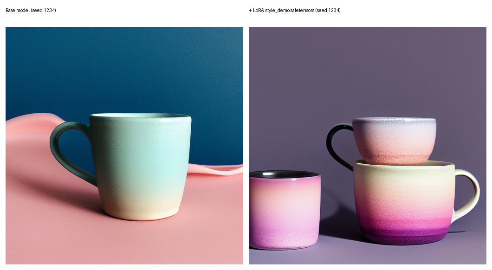
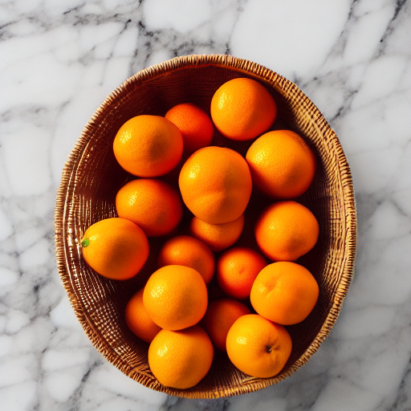

# aigc-lab

**ComfyUI 工作流 + 自定义节点 + 批量出图 + SD1.5 LoRA 训练**，在 4 GB 显存的笔记本上跑通全流程。


---

## 成果

### base vs LoRA（同 prompt、同 seed）



左：原模型 ｜ 右：加载了自训 LoRA（`skyshop style`）。风格迁移明显——粉紫渐变、釉面质感。

### 批量出图（10 张，54 秒）



---

## 实测数据

| 项 | 数值 | 环境 |
|---|---|---|
| 单张出图（512×512 / 20 步） | **4.5–4.9 秒** | RTX 3050 Laptop 4 GB |
| 批量 10 张 | **54 秒**，0 失败 | 同上 |
| 首张（含模型加载） | 12.2 秒 | 同上 |
| CPU 对比（384×384 / 6 步） | 39 秒 | 慢 8 倍 |
| 数据集生成 20 张 + 自动标签 | 1.7 分钟 | 同上 |
| **LoRA 训练 1000 步** | **19 分 15 秒**，1.16 秒/步 | Kaggle T4 16 GB |
| **loss** | 0.18 → **0.069** | |
| LoRA 模型大小 | 36 MB（rank 32） | |
| **本地 LLM 推理（Qwen2.5-0.5B）** | **1.0 GB 显存 / 3.3–4.3 tokens/s** | RTX 3050 4 GB |

---

## 目录

```
custom_nodes/prompt_batch/   自定义节点：按序号取提示词 + 生成带序号文件名
scripts/batch_run.py         批量出图（调 ComfyUI HTTP API）
scripts/lora_compare.py      base vs LoRA 对比图生成
scripts/check_env.ps1        环境自检（显卡/显存/Python/磁盘）
workflows/txt2img_api.json   API 格式工作流（可直接用）
train/make_dataset.py        生成训练素材 + 自动打标签
train/kaggle_sd15_lora.ipynb Kaggle T4 训练 notebook
train/kohya_sd15_lora.toml   kohya 训练配置（4G 极限档）
docker/Dockerfile            ComfyUI 的 GPU 镜像
dataset_style/               20 张训练图 + 对应标签
samples/                     出图样例与对比图
docs/                        实测数据、踩坑记录、数据集指南
```

---

## 快速开始

### 0. 环境自检

```powershell
powershell -ExecutionPolicy Bypass -File scripts\check_env.ps1
```

### 1. 装 ComfyUI

```powershell
# 便携版解压后
run_nvidia_gpu.bat
```

> **驱动必须 ≥ 580**，否则要用 `cu126` 版本的便携包（详见 [docs/measurements.md](docs/measurements.md)）。

### 2. 装自定义节点

```powershell
xcopy /E /I custom_nodes\prompt_batch <ComfyUI目录>\custom_nodes\prompt_batch
```

重启 ComfyUI → 节点面板 → `custom/batch` → **Prompt From File (batch)**

### 3. 批量出图

```powershell
python scripts\batch_run.py --workflow workflows\txt2img_api.json --prompts prompts.txt --out out
```

```
提示词 10 条 | 文本节点 6 | 采样节点 3 | 输出 out
  [1/10]  12.2s  a photo of a ceramic coffee mug...
  [2/10]   4.5s  a leather backpack on a concrete floor...
完成 10 张，失败 0 张，总耗时 0.9 分钟，平均 5.4 秒/张
```

### 4. 生成训练素材（可选）

```powershell
python train\make_dataset.py --n 20 --out dataset_style
```

固定风格 + 换 20 个主体，自动生成图和标签（5.2 秒/张）。

### 5. 训 LoRA（上云）

本机 4 GB 显存训不动，用 [train/kaggle_sd15_lora.ipynb](train/kaggle_sd15_lora.ipynb) 上 Kaggle 免费 T4。

### 6. 对比验证

```powershell
python scripts/lora_compare.py ^
  --prompt "a ceramic mug, product photo, soft studio lighting, pastel gradient background" ^
  --lora style_demo.safetensors --seed 1234
```

---

## 踩过的坑

| 问题 | 现象 | 解决 |
|---|---|---|
| ComfyUI cu130 版启动崩 | `access violation` in `torch.cuda._lazy_init` | torch 2.14+cu130 需驱动 ≥580 → 换 **cu126** 版 |
| **显卡被禁用** | `No CUDA GPUs are available` | `pnputil /enum-devices /class Display` 看 `Status: Disabled` → 设备管理器启用 |
| kohya 报 No data found | `train_data_dir must be the parent of folders` | 目录要 `train_data/10_style/图片` |
| accelerate 双卡崩 | `ChildFailedError` | 改单进程 `python train_network.py` |
| pip 重装 torch 卡 2 小时 | session 超时，文件全丢 | `grep -v torch requirements.txt` |
| Kaggle 数据集不挂载 | `/kaggle/input` 为空 | 数据集只在 session 启动时挂载 |
| Kaggle 输出拿不出来 | Output 页空 | Quick Save 不打包 → 必须 `Save & Run All (Commit)` |

完整排查过程：[docs/measurements.md](docs/measurements.md) · [docs/lora_training.md](docs/lora_training.md)

---

## 说明

- LoRA 权重（36 MB）未入库，按上面步骤可复现（训练 20 分钟）
- 训练素材由 AI 生成，"风格蒸馏"用途；真实电商场景建议用真实商品图
- 本机 4 GB 显存：SD1.5 出图没问题，SDXL 和视频跑不动

---

MIT License
